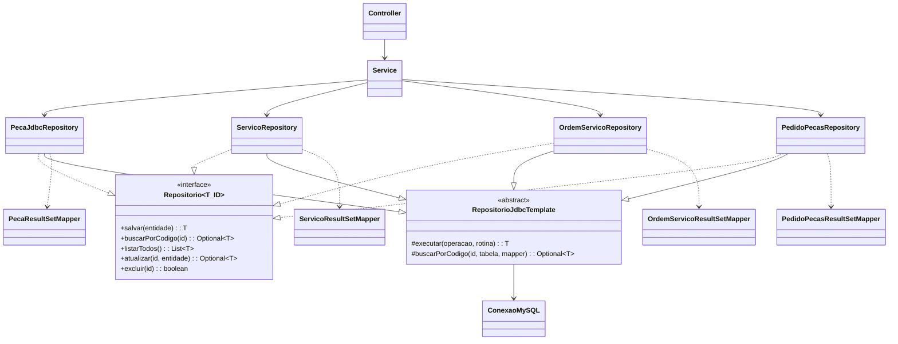

# Diagrama de Classes - API MecâniQA OAT 3

O diagrama destaca a camada de serviço, o contrato genérico dos repositórios JDBC e o
Template Method que controla o ciclo de vida das conexões.

Os controllers não chamam repositories. O `RepositorioJdbcTemplate` centraliza a abertura
e o fechamento da conexão, e cada repositório implementa suas queries SQL e mapeamento.
